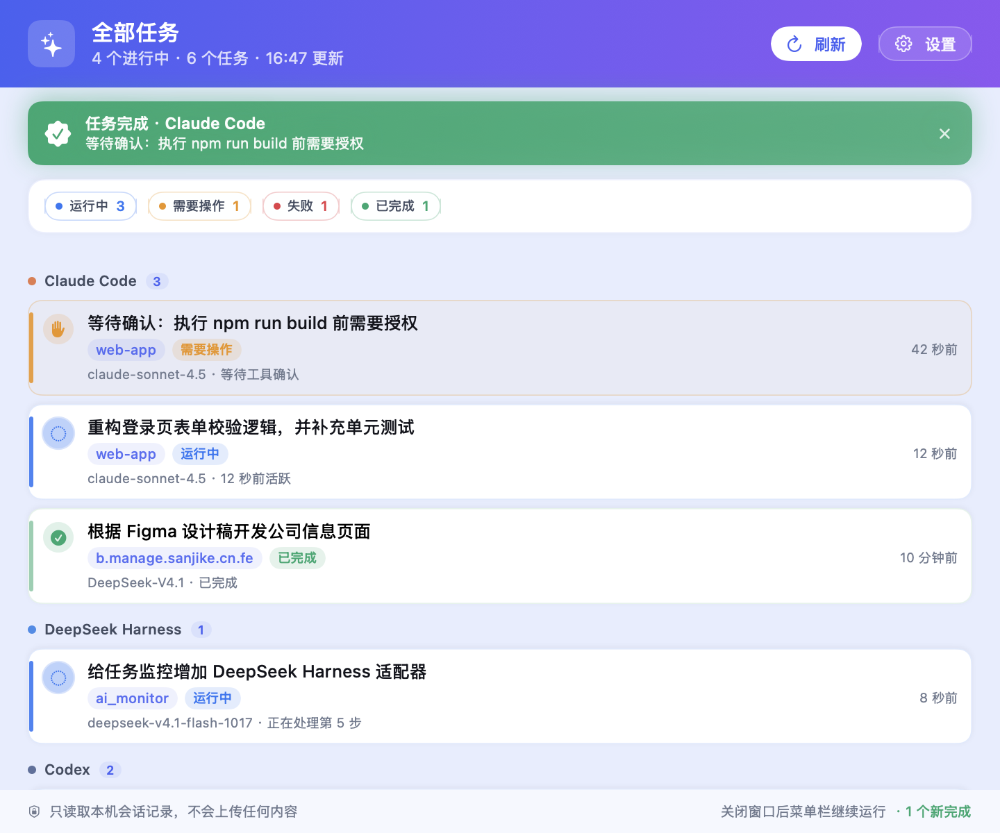

# AI 任务监控（AI Monitor）

macOS 原生小工具：**菜单栏常驻 + 一个只列 AI 的小浮窗 + 一个看完整任务的主界面**。实时查看本机不同 AI 编码助手（Claude Code、Codex、DeepSeek Harness 等）在跑什么、谁卡在确认、谁失败、谁已经完成。

界面完全本地化，不联网、不上传任何数据，只读取各 AI 工具自己写在磁盘上的会话记录。



## 两个界面

### 小浮窗（默认显示）


- **只列 AI，不显示具体任务**：每个 AI 一行，右侧是状态摘要（运行 / 待操作 / 失败 / 已完成 / 空闲）
- 尺寸很小（约 200pt 宽），AI 越多高度才会略微增加，不会占屏幕
- 拖动任意一行或顶部标题即可移动，位置会记住
- **点击任意一行打开主界面**；点右上角 × 只是收起浮窗
- 有任务完成时，对应 AI 的那一行会短暂变绿，不弹大横幅
- 完成时会在**浮窗正上方**出现一个轻量的完成提示条（可点击打开主界面），即使系统通知被关闭也不会漏掉；浮窗收起后提示条停在原位置

### 主界面

- 完整任务列表：按 AI 分组，显示任务标题、项目、状态、最后活跃时间
- 顶部统计四种状态的数量；任务完成时出现绿色横幅
- 「刷新」「设置」按钮，支持 `⌘R` / `⌘,`
- 主界面打开时会出现在 **Cmd+Tab** 和 Dock 里；关闭后回到菜单栏模式，不占用 Dock
- 关闭主窗口不会退出，菜单栏和浮窗继续运行

入口：菜单栏 ✨ → **打开主界面**，或直接点浮窗里的任意 AI。

| 初始化 | 设置 |
| --- | --- |
|  |  |

## 功能一览

- **监控本机已有的 AI**：自动扫描 Claude Code、Codex、DeepSeek Harness，以及 Gemini CLI / Aider / Ollama / Cursor Agent 等命令行工具
- **首次启动有初始化流程**：扫描 → 勾选要监控的 AI → 进入小浮窗；之后可在设置里随时增删
- **四种任务状态**：运行中、需要操作、失败、已完成
- **完成提示**：浮窗上方的完成提示条 + 系统通知（授权后）+ 主界面绿色横幅 + 浮窗对应 AI 行变绿 + 菜单栏未读计数
- **不依赖通知权限**：即使系统通知被关闭，顶部提示条和界面变化仍然能看到；提示条可点击直接打开主界面
- **菜单栏图标下拉菜单**：打开主界面、按 AI 分组列出任务、显示/隐藏浮窗、刷新、静音、设置、退出
- **关闭窗口不退出**：浮窗或主界面关掉后，应用仍在菜单栏运行

## 支持监控哪些 AI

| AI | 数据来源 | 能识别到的状态 |
| --- | --- | --- |
| **Claude Code**（含 VS Code 扩展 / CLI） | `~/.claude/sessions/*.json` + `~/.claude/projects/**/*.jsonl` | 运行中 / 需要操作 / 已完成 / 失败 |
| **Codex**（Codex CLI / Codex Desktop） | `~/.codex/sessions/YYYY/MM/DD/rollout-*.jsonl` | 运行中 / 需要操作 / 已完成 / 失败 |
| **DeepSeek Harness**（dsh） | `~/.dsh/storages/session_projcache/sessions/session-*.json` | 运行中 / 需要操作 / 已完成 / 失败 |
| **其他 AI CLI** | 进程列表（`gemini`、`aider`、`ollama run`、`cursor-agent`、`opencode`、`qwen`、`goose`、`crush`、`amp`、`llm`、`sgpt`） | 运行中（进程级） |
| **桌面应用**（ChatGPT / Claude / Cursor / Windsurf / Ollama） | `/Applications` 安装检测 | 仅提示已安装，不支持任务级状态 |

### 状态是怎么判断的

Claude Code：

- 会话进程还在 + 最近有写入 → **运行中**
- 最后一条是带工具调用的 assistant 消息，且超过 3 分钟没有新写入 → **需要操作**（通常是在等权限确认）
- 一轮回复已收尾（最后一条 assistant 只有文本）→ **已完成**
- 你点了停止 / 按 Esc，记录里出现 `[Request interrupted by user]` → **已完成**（详情标「已手动停止」）
- 最后一条是 API 错误 / 进程异常 → **失败**
- 进程结束但记录在 6 小时内 → 作为**历史任务**展示

Codex：

- `task_started` → **运行中**；超过 5 分钟无写入 → **需要操作**
- `task_complete` → **已完成**
- `turn_aborted` 且 reason 是 `interrupted` / `cancelled`（用户主动停止）→ **已完成**
- 其他 `turn_aborted` / `error` → **失败**

DeepSeek Harness（dsh）：

- 当前轮次未结束（`openTurnStartSeq` 有值）且 3 分钟内有进展 → **运行中**
- 同一轮次超过 3 分钟没有新进展，或存在待你回答的问题 → **需要操作**
- 轮次正常结束 → **已完成**
- `llmRetry` / `goal.failure` 有内容 → **失败**

> dsh 的原始会话是 `session.v4.jsonl.zstd` 压缩文件；这里不解压它，而是读 dsh 自己维护的投影缓存（未压缩 JSON），更轻、也不会和 dsh 抢文件锁。

> 「需要操作」是基于会话写入间隔的推断。Claude Code 目前没有把权限弹窗写成独立事件，所以无法做到 100% 精确；这也是多数本地监控工具的通用做法。

## 安装与运行

### 从 GitHub 源码运行（开发者）

仓库只包含源码，**不包含 `dist/` 里的 .app**（构建产物已被 `.gitignore` 忽略）。下载后需要本机编译一次。

要求：macOS 14+、Xcode Command Line Tools（提供 `swiftc`）。

```bash
xcode-select --install      # 如果还没装命令行工具
git clone https://github.com/haobosen/ai_monitor.git
cd ai_monitor
./build.sh
open "dist/AI Monitor.app"
```

构建完成后，把 `dist/AI Monitor.app` 拖到「应用程序」即可。首次启动会走初始化流程。

### 直接分发 .app（普通用户）

如果希望别人下载后直接双击使用，可以把构建好的 app 打成 zip，上传到 GitHub 的 **Releases**：

```bash
ditto -c -k --keepParent "dist/AI Monitor.app" "AI Monitor.zip"
```

对方解压后拖进「应用程序」。因为应用是 ad-hoc 签名、没有经过 Apple 公证，第一次打开需要：

1. 右键点 `AI Monitor.app` →「打开」→ 再点「打开」
2. 如果仍被拦截，执行：

```bash
xattr -dr com.apple.quarantine "/Applications/AI Monitor.app"
```

> 注意：`build.sh` 默认只编译当前机器架构（Apple Silicon 构建的包不能在 Intel 上运行）。要同时支持两种芯片，需要在对应机器上分别构建，或把脚本改成 universal binary。

### 已经在本机构建过

应用在：

```
dist/AI Monitor.app
```

双击打开即可。想放到「应用程序」里，把整个 `AI Monitor.app` 拖到 `/Applications` 就行（首次启动前建议先退出正在运行的旧版本）。

首次启动会：

1. 自动扫描本机 AI（约 1 秒）
2. 列出可监控项，默认勾选 Claude Code / Codex / DeepSeek Harness（有数据的才会勾上）
3. 点「开始监控」后显示小浮窗，并弹出系统通知授权

允许通知后，任务完成时会有系统横幅 + 提示音；如果拒绝授权或系统通知被关闭，顶部的完成提示条、主界面横幅、浮窗高亮和菜单栏计数仍然可用。需要重新开启通知时，到「系统设置 → 通知 → AI 任务监控」里打开即可。

## 菜单栏

点击菜单栏的 ✨ 图标：

- 顶部显示当前进行中的任务数
- 按 AI 分组列出每个任务，点击任意任务会打开主界面
- **打开主界面**
- **显示浮窗 / 隐藏浮窗**
- **立即刷新**
- **静音通知**
- **设置…**
- **退出 AI Monitor**

## 开发与构建

要求：macOS 14+，Xcode Command Line Tools（Swift 6 工具链）。

```bash
./build.sh
open "dist/AI Monitor.app"
```

构建脚本会：

1. 用 `swiftc` 编译 `Sources/AIMonitor/*.swift`
2. 组装 `.app`（`Resources/Info.plist` + 图标）
3. 做 ad-hoc 签名

### 调试参数

```bash
BIN="dist/AI Monitor.app/Contents/MacOS/AIMonitor"

"$BIN" --discover          # 列出扫描到的 AI
"$BIN" --dump              # 以 JSON 打印当前任务，便于排查适配器
"$BIN" --reset-config      # 清空配置（下次启动重新走初始化）
"$BIN" --mark-onboarded    # 跳过初始化，直接进浮窗
"$BIN" --main              # 启动后直接打开主界面
"$BIN" --snapshot <dir>    # 离屏渲染界面截图（不需要录屏权限）
"$BIN" --settings --snapshot <dir>   # 截图设置页
```

运行日志：`~/Library/Logs/AIMonitor.log`

### 目录结构

```
Sources/AIMonitor/
  main.swift                  启动 / 调试入口
  AppDelegate.swift           应用装配与初始化流程
  AppConfig.swift             配置（监控哪些 AI、通知开关）
  AIProviderCatalog.swift     扫描本机可监控的 AI
  MonitorEngine.swift         定时汇总各适配器
  Adapters/
    ClaudeAdapter.swift       Claude Code 会话解析
    CodexAdapter.swift        Codex rollout 增量解析
    DSHAdapter.swift          DeepSeek Harness 会话缓存解析
    CLIAdapter.swift          其他 AI CLI 进程
  PanelController.swift       小型 AI 浮窗
  MainWindowController.swift  主界面窗口
  MenuBarController.swift     菜单栏图标与下拉菜单
  TaskNotifier.swift          系统通知 + 完成回调
  UI/
    CompactView.swift         浮窗界面（只列 AI）
    MainView.swift            主界面（完整任务列表）
    TaskStore.swift           任务状态仓库
    Components.swift          状态点、任务行、横幅等
    SetupView.swift           初始化 / 设置
  SnapshotRenderer.swift      离屏截图（调试）
Resources/Info.plist          应用元信息（LSUIElement，无 Dock 图标）
build.sh                      构建脚本
docs/                         界面预览图
```

### 想再加一种 AI

1. 在 `Sources/AIMonitor/Adapters/` 里实现一个 `scan() -> [AITask]`（参考 `ClaudeAdapter`）
2. 在 `AIProviderCatalog.discover()` 里声明它，返回 `DetectedAI`
3. 在 `MonitorEngine.scanOnce()` 里按开关决定是否调用
4. 在设置页加对应的 `id` 即可

如果只是命令行工具，把可执行文件名加到 `ProcessProbe.knownCLI` 就够了。

## 已知限制

- 只监控**会话记录落盘**的 AI。纯网页版 / 没有本地记录的工具无法读取任务状态。
- DeepSeek Harness 读的是投影缓存；如果 dsh 刚启动还没写缓存，最多滞后一两秒。
- Codex 的 `.jsonl.zst` 历史归档不做解析，只读最近的 `.jsonl`。
- 桌面聊天应用（ChatGPT、Claude 客户端）没有对外暴露任务接口，只能检测是否安装。
- 状态阈值（3 分钟 / 5 分钟）是按常见使用节奏设定的，可以在适配器里调整。
- 本地 ad-hoc 签名；如果要分发给别人，需要用自己的开发者证书签名并公证。
- 没有做登录项自启动，需要的话在「系统设置 → 通用 → 登录项」里添加 `AI Monitor.app`。

## 隐私

所有数据都来自本机只读文件与进程列表，应用不包含网络请求代码，不会上传任务标题、路径或任何会话内容。
