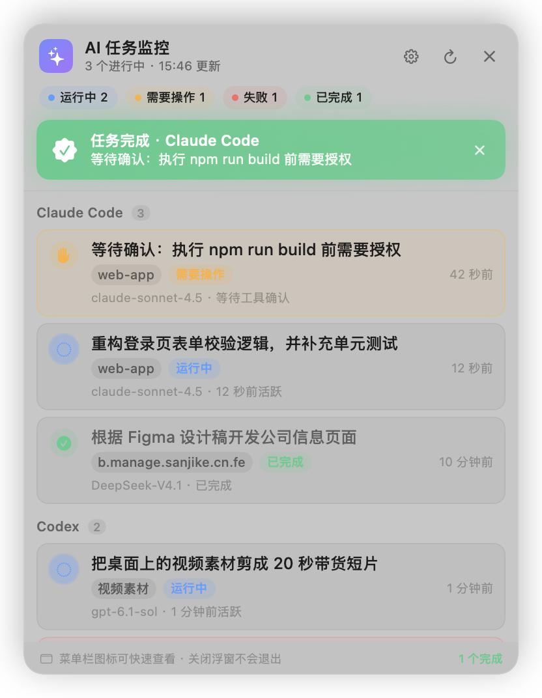
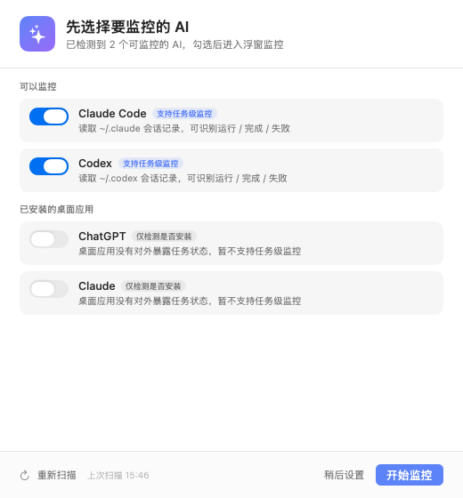
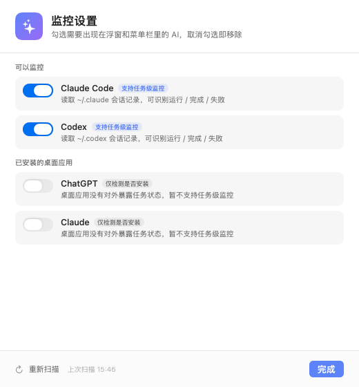

# AI 任务监控（AI Monitor）

macOS 原生浮窗 + 菜单栏小工具，实时查看本机不同 AI 编码助手正在执行的任务：谁在跑、谁卡在确认、谁失败、谁已经完成。

界面完全本地化，不联网、不上传任何数据，只读取各 AI 工具自己写在磁盘上的会话记录。



## 功能一览

- **监控本机已有的 AI**：自动扫描 Claude Code、Codex，以及 Gemini CLI / Aider / Ollama / Cursor Agent 等命令行工具
- **首次启动有初始化流程**：扫描 → 勾选要监控的 AI → 进入浮窗；之后可在设置里随时增删
- **四种任务状态**：运行中、需要操作、失败、已完成
- **浮窗可拖动**：常驻置顶，可跨桌面空间显示；拖动标题区域即可移动，位置会记住
- **完成提示足够明显**：系统通知 + 浮窗顶部绿色横幅 + 菜单栏图标上的未完成计数
- **菜单栏图标下拉菜单**：按 AI 分组列出所有任务，可显示/隐藏浮窗、立即刷新、静音通知、打开设置、退出
- **关闭浮窗不退出**：点浮窗右上角 × 只是收起，菜单栏继续运行

| 初始化 | 设置 |
| --- | --- |
|  |  |

## 支持监控哪些 AI

| AI | 数据来源 | 能识别到的状态 |
| --- | --- | --- |
| **Claude Code**（含 VS Code 扩展 / CLI） | `~/.claude/sessions/*.json` + `~/.claude/projects/**/*.jsonl` | 运行中 / 需要操作 / 已完成 / 失败 |
| **Codex**（Codex CLI / Codex Desktop） | `~/.codex/sessions/YYYY/MM/DD/rollout-*.jsonl` | 运行中 / 需要操作 / 已完成 / 失败 |
| **其他 AI CLI** | 进程列表（`gemini`、`aider`、`ollama run`、`cursor-agent`、`opencode`、`qwen`、`goose`、`crush`、`amp`、`llm`、`sgpt`） | 运行中（进程级） |
| **桌面应用**（ChatGPT / Claude / Cursor / Windsurf / Ollama） | `/Applications` 安装检测 | 仅提示已安装，不支持任务级状态 |

### 状态是怎么判断的

Claude Code：

- 会话进程还在 + 最近有写入 → **运行中**
- 最后一条是带工具调用的 assistant 消息，且超过 3 分钟没有新写入 → **需要操作**（通常是在等权限确认）
- 一轮回复已收尾（最后一条 assistant 只有文本）→ **已完成**
- 最后一条是 API 错误 / 进程异常 → **失败**
- 进程结束但记录在 6 小时内 → 作为**历史任务**展示

Codex：

- `task_started` → **运行中**；超过 5 分钟无写入 → **需要操作**
- `task_complete` → **已完成**
- `turn_aborted` / `error` → **失败**

> 「需要操作」是基于会话写入间隔的推断。Claude Code 目前没有把权限弹窗写成独立事件，所以无法做到 100% 精确；这也是多数本地监控工具的通用做法。

## 安装与运行

已构建好的应用在：

```
dist/AI Monitor.app
```

双击打开即可。想放到「应用程序」里，把整个 `AI Monitor.app` 拖到 `/Applications` 就行（首次启动前建议先退出正在运行的旧版本）。

首次启动会：

1. 自动扫描本机 AI（约 1 秒）
2. 列出可监控项，默认勾选 Claude Code / Codex
3. 点「开始监控」后显示浮窗，并弹出系统通知授权

允许通知后，任务完成时会有系统横幅 + 提示音；如果拒绝授权，浮窗内横幅和菜单栏计数仍然可用。

## 菜单栏

点击菜单栏的 ✨ 图标：

- 顶部显示当前进行中的任务数
- 按 AI 分组列出每个任务（状态用 🟠🔵🔴🟢 标识），点击任意任务会展开浮窗
- **显示浮窗 / 隐藏浮窗**
- **立即刷新**
- **静音通知**
- **设置…**
- **退出 AI Monitor**

浮窗里点击右上角齿轮也能直接打开设置。

## 开发与构建

要求：macOS 14+，Xcode Command Line Tools（Swift 6 工具链）。

```bash
./build.sh
open "dist/AI Monitor.app"
```

构建脚本会：

1. 用 `swiftc` 编译 `Sources/AIMonitor/*.swift`
2. 组装 `.app`（`Resources/Info.plist` + 图标）
3. 做 ad-hoc 签名

### 调试参数

```bash
BIN="dist/AI Monitor.app/Contents/MacOS/AIMonitor"

"$BIN" --discover          # 列出扫描到的 AI
"$BIN" --dump              # 以 JSON 打印当前任务，便于排查适配器
"$BIN" --reset-config      # 清空配置（下次启动重新走初始化）
"$BIN" --mark-onboarded    # 跳过初始化，直接进浮窗
"$BIN" --snapshot <dir>    # 离屏渲染界面截图（不需要录屏权限）
"$BIN" --settings --snapshot <dir>   # 截图设置页
```

运行日志：`~/Library/Logs/AIMonitor.log`

### 目录结构

```
Sources/AIMonitor/
  main.swift                  启动 / 调试入口
  AppDelegate.swift           应用装配与初始化流程
  AppConfig.swift             配置（监控哪些 AI、通知开关）
  AIProviderCatalog.swift     扫描本机可监控的 AI
  MonitorEngine.swift         定时汇总各适配器
  Adapters/
    ClaudeAdapter.swift       Claude Code 会话解析
    CodexAdapter.swift        Codex rollout 增量解析
    CLIAdapter.swift          其他 AI CLI 进程
  PanelController.swift       可拖动置顶浮窗
  MenuBarController.swift     菜单栏图标与下拉菜单
  TaskNotifier.swift          系统通知 + 完成回调
  UI/                         SwiftUI 界面
Resources/Info.plist          应用元信息（LSUIElement，无 Dock 图标）
build.sh                      构建脚本
docs/                         界面预览图
```

### 想再加一种 AI

1. 在 `Sources/AIMonitor/Adapters/` 里实现一个 `scan() -> [AITask]`（参考 `ClaudeAdapter`）
2. 在 `AIProviderCatalog.discover()` 里声明它，返回 `DetectedAI`
3. 在 `MonitorEngine.scanOnce()` 里按开关决定是否调用
4. 在设置页加对应的 `id` 即可

如果只是命令行工具，把可执行文件名加到 `ProcessProbe.knownCLI` 就够了。

## 已知限制

- 只监控**会话记录落盘**的 AI。纯网页版 / 没有本地记录的工具无法读取任务状态。
- Codex 的 `.jsonl.zst` 历史归档不做解析，只读最近的 `.jsonl`。
- 桌面聊天应用（ChatGPT、Claude 客户端）没有对外暴露任务接口，只能检测是否安装。
- 状态阈值（3 分钟 / 5 分钟）是按常见使用节奏设定的，可以在适配器里调整。
- 本地 ad-hoc 签名；如果要分发给别人，需要用自己的开发者证书签名并公证。
- 没有做登录项自启动，需要的话在「系统设置 → 通用 → 登录项」里添加 `AI Monitor.app`。

## 隐私

所有数据都来自本机只读文件与进程列表，应用不包含网络请求代码，不会上传任务标题、路径或任何会话内容。
